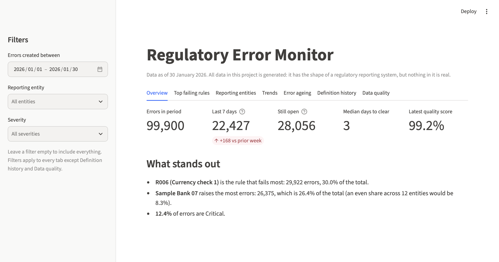
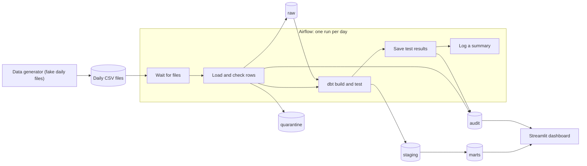
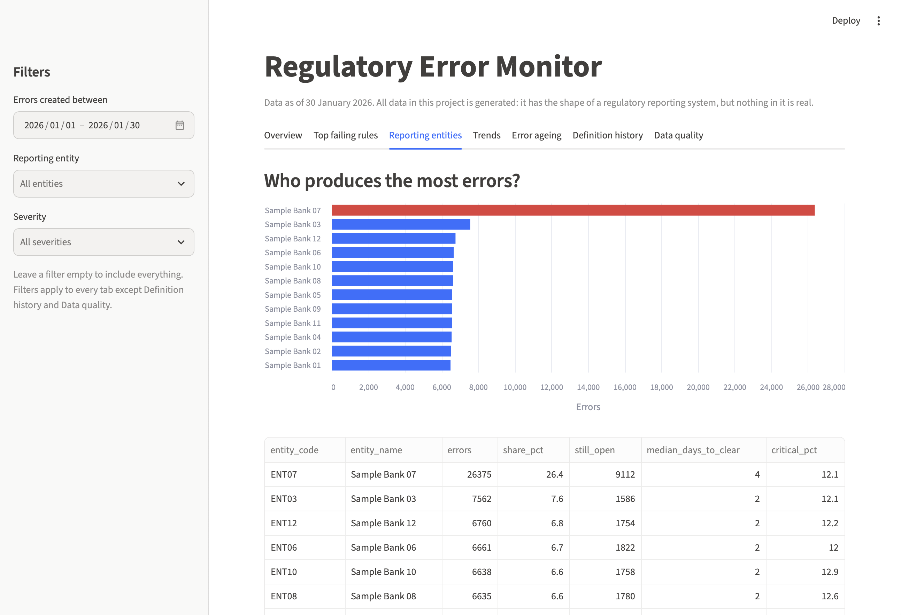
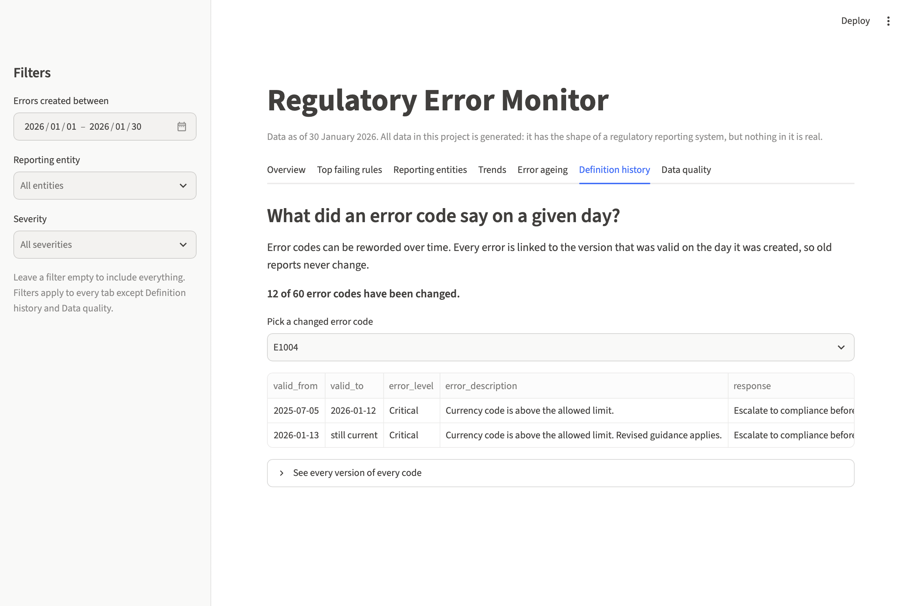
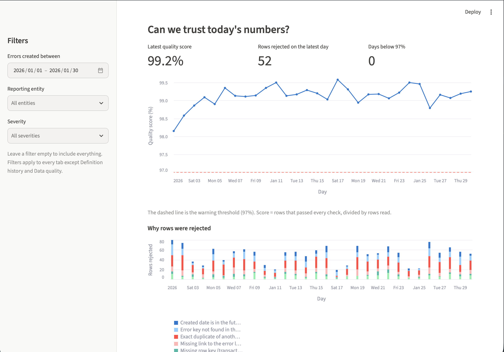
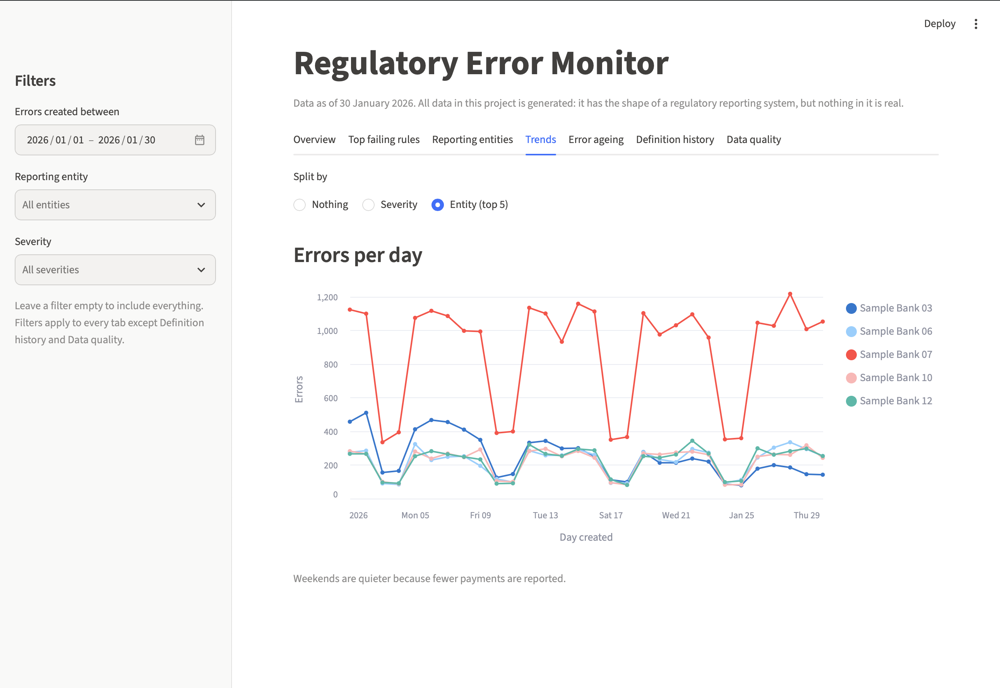

# Regulatory Error Monitoring Warehouse

[](https://github.com/terrence0909/regulatory-error-monitor/actions/workflows/ci.yml)

A data pipeline for payment validation errors, the kind a bank deals with when it reports payments to a regulator. It loads daily files, keeps every bad row in a quarantine table with a plain-English reason, tracks how error definitions change over time, tests the data, runs every day on a schedule, and shows what is failing on a dashboard.

> **The data is generated.** It has the shape of a regulatory reporting system, but it contains no real transactions, names or accounts. The reporting rules are simplified for the project.



## What it answers

- Which rules and error codes fail the most, and is it getting better or worse?
- Which reporting entities produce the most errors, and which are slow to clear them?
- How old are the open errors?
- What did an error code say on the day a payment failed, even if its wording changed later?
- Can we trust today's numbers?

## How it fits together



| Schema | What is in it |
|---|---|
| `raw` | Data exactly as it arrived. Every batch is kept. |
| `quarantine` | Rows that failed a check, with the reason. Never silently dropped. |
| `audit` | What the loader did, and the results of every dbt test run. |
| `staging` | Cleaned, de-duplicated copies of raw. |
| `marts` | The tables the dashboard reads: one fact table, five dimensions and the daily quality score. |

## Quick start

You need Docker (about 6 GB of memory allowed) and Python 3.8 or newer.

```bash
cp .env.example .env              # then open .env and change the passwords
docker compose up -d --build     # database, Airflow and the dashboard (first build takes several minutes)
python3 generator/generate.py    # makes 30 days of fake data in data/landing
```

Then:

1. Open Airflow at <http://localhost:8080> (user `admin`, password from `AIRFLOW_ADMIN_PASSWORD` in `.env`).
2. Switch on **regulatory_error_monitor**. It processes the 30 days one after another, in about five minutes.
3. Open the dashboard at <http://localhost:8501>.

If port 5432 or 8080 is already in use on your computer, change `POSTGRES_PORT` in `.env`, or the left side of the port line in `docker-compose.yml`.

### Run the pieces by hand

```bash
python3.12 -m venv .venv && source .venv/bin/activate
pip install -r requirements.txt

python3 loader/load_batch.py --all     # load every day, quarantine bad rows
bash run_build.sh                      # dbt build and test, then save the results
python3 loader/verify_load.py          # proves every planted problem was caught
```

## The dashboard

| | |
|---|---|
|  |  |
| Which entities produce the most errors | What an error code said on a given day |
|  |  |
| Quality score, rejected rows and test results | Errors per day, split by severity or entity |

## Design decisions

**Keep every version of an error definition.** The error lookup changes over time. Each error is linked to the version that was valid **on the day it was created**, not the latest one, so old reports never change when someone rewrites a description. A test proves it, and another checks that no two versions of a code overlap.

**Never drop a bad row silently.** The loader checks every row and sends failures to a quarantine table with a reason such as "Error key not found in the error lookup". The daily quality score is the share of rows that passed.

**Loads can be repeated.** Each day is one database transaction that first removes what that day loaded before. Running a day twice gives the same result, and a failure cannot leave half a day behind.

**Incremental, with a look-back window.** The fact table and the cleaning step only reprocess the last few days, so late-arriving rows and newly cleared errors are picked up without rebuilding everything.

**Stop on serious problems, warn on soft ones.** Broken keys and broken links fail the build, so Airflow stops. A bad quality score, or a new error level the lookup has never seen, only warns. Test results are saved even when the build fails.

**No dbt snapshot for rule history.** A snapshot is for a source that overwrites rows and keeps no history. The loader already keeps every batch, so the history is in `raw`, and `dim_rule` reads it directly.

More detail is in [docs/data_model.md](docs/data_model.md) and [docs/data_quality.md](docs/data_quality.md). Every column is explained in [docs/data_dictionary.md](docs/data_dictionary.md).

## Data quality

| Layer | What it catches |
|---|---|
| Loader checks | Missing keys, keys that point to nothing, impossible dates, exact duplicates |
| dbt tests (60) | Broken links between tables, overlapping history, wrong statuses, rows lost on the way |
| Daily quality score | A day that is much worse than usual (a warning below 97%) |

The generator plants six kinds of bad data on purpose and records exactly how many of each. `loader/verify_load.py` then checks the quarantine table holds exactly those numbers. A separate script, `generator/make_bad_day.py`, builds one day where about 28% of rows are broken, and CI checks the pipeline warns about it without stopping.

## Performance

Measured on a laptop (8 cores) with PostgreSQL in Docker, taking the median of three runs where a new day arrives. The benchmark compares the first version of the cleaning step (a view that re-cleaned all history on every run) with the current incremental version.

| History | Fact rows | Cleaning and fact work: before | after | Daily dbt run: before | after |
|---|---|---|---|---|---|
| 30 days | 971,328 | 5.8 s | 5.6 s | 7.5 s | 6.8 s |
| 60 days | 1,917,765 | 14.6 s | 5.8 s | 16.8 s | 8.1 s |

At 30 days the two versions look almost the same. When the history doubled, the old version took about 2.5 times longer, and the new one stayed flat. The whole daily run still rises slightly, because a few small models read whole tables. Full details, and how to run the benchmark yourself, are in [docs/performance.md](docs/performance.md).

## Tests and checks

- **14 unit tests** for the row checks (`python3 -m pytest -q`)
- **72 dbt steps** on every build: 12 models and 60 tests
- **A dashboard smoke test** that opens every tab and changes the filters
- **GitHub Actions** runs all of it on every push, on a fresh database: linting (ruff and sqlfluff), the pipeline build, a deliberately bad day, and the dashboard test

## Project layout

```
generator/      fake data: daily files, a checker, and a "bad day" maker
loader/         loads files, quarantines bad rows, saves dbt test results
dbt_project/    staging, marts, tests and the daily quality models
airflow/        the daily pipeline (DAG) and its Docker image
dashboard/      the Streamlit app
benchmarks/     before-and-after performance benchmark
tests/          unit tests and the dashboard smoke test
sql/init/       database setup, run once when the database is created
docs/           data model, data dictionary, data quality, performance
.github/        the automated checks
```

## Limits

- The data is generated, and the rules are a simplified version of what a real reporting system would enforce.
- Everything runs on one machine in Docker. Airflow uses a single local worker, and there is no login on the dashboard.
- The incremental models only look back a few days. If you reload an old day with corrected data, run `bash run_dbt.sh run --full-refresh` so the change is picked up.
- The dashboard loads the whole fact table into memory and caches it for five minutes. That is fine at about a million rows. Past that, its summaries should run inside the database.

## Built with

Python, PostgreSQL 16, dbt, Apache Airflow 2.10, Docker, Streamlit and GitHub Actions.