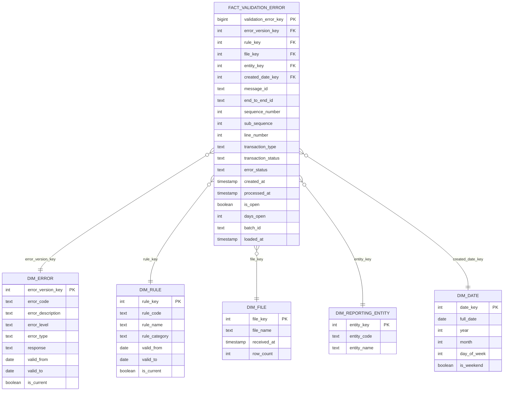

# Data model

## The grain

**One row in the fact table is one validation error found on one transaction line.**

Every design choice below follows from this sentence. If a payment fails three checks, it produces three rows.

## Layers

| Schema | Purpose | Who reads it |
|---|---|---|
| `raw` | Data exactly as it arrives, plus `batch_id` and `loaded_at` | The loader and dbt only |
| `staging` | Cleaned, typed, de-duplicated copies of raw | dbt only |
| `marts` | The star schema the dashboard reads | Dashboard and analysts |
| `quarantine` | Rows that failed checks, with the reason | Data quality page |
| `audit` | Load logs and test results | Data quality page |

## Diagram (marts layer)

## Design decisions

### 1. How history works

The error lookup keeps old versions. When an error's description changes, the old version gets an inactive date and a new version is added with its own key.

- Each version has its own key (`error_version_key`), a `valid_from` date and a `valid_to` date.
- The current version uses `9999-12-31` as its `valid_to` date, so date comparisons stay simple.
- A fact row is joined to the version that was active **on the date the error was created**, not the latest version. This is called a point-in-time join. It stops old reports from changing when someone rewrites a description.

The rule lookup is different. Rules are overwritten in place, so history is captured with a dbt snapshot (phase 5).

### 2. What open and closed mean

- An error is **closed** when `processed_at` is filled in.
- An error is **open** when `processed_at` is empty.
- `days_open` is `processed_at - created_at` for closed errors, and `today - created_at` for open ones.

This is an assumption. If you can justify a different rule, change it here first, then in the models.

### 3. What happens to bad rows

Bad rows are never silently dropped. The loader sends them to `quarantine.rejected_rows` with a plain-English reason and the batch they came from. A row is rejected for:

- A missing key
- A key that points to nothing
- A date in the future
- A processed date earlier than the created date
- An exact duplicate within the same batch

### 4. Duplicated columns in the source

The source repeats `error_type` and `error_description` on both tables, and has two processed-date columns (`processed_date` and `processed_date_time`). In staging:

- The error lookup is the single source of truth for type and description.
- `processed_date_time` is used when present, and `processed_date` fills the gap.

### 5. Keys

All warehouse keys are integers generated in the warehouse. Source keys are kept as columns so rows can be traced back.

## Assumptions to confirm

| # | Assumption | Why it matters |
|---|---|---|
| 1 | One row in the source validation table is one error on one transaction line | Defines the grain |
| 2 | Source lookup rows are versioned, so a changed description means a new row | Drives the history design |
| 3 | A filled `processed_date` means the error is cleared | Drives open and closed |
| 4 | Late rows arrive at most a few days after creation | Sets the incremental look-back window |
| 5 | The rule and file tables are small and simple | They are invented for this project |
