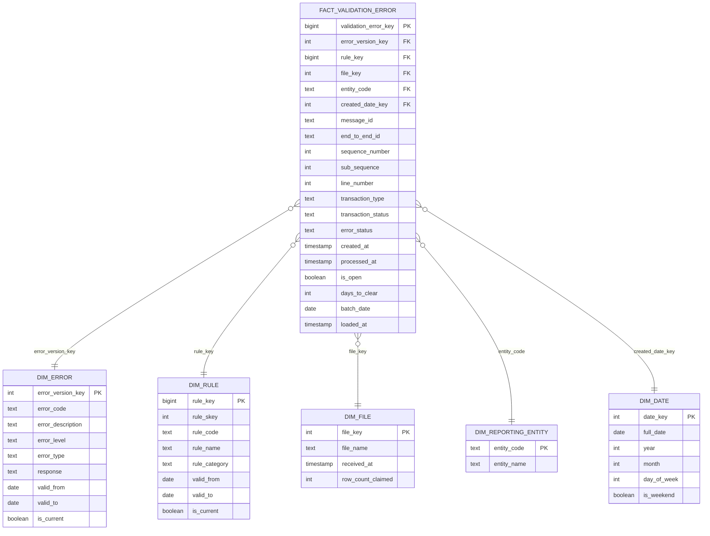

# Data model

## The grain

**One row in the fact table is one validation error found on one transaction line.**

Every design choice below follows from this sentence. If a payment fails three checks, it produces three rows.

## Layers

| Schema | Purpose | Who reads it |
|---|---|---|
| `raw` | Data exactly as it arrives, plus `batch_id` and `loaded_at` | The loader and dbt only |
| `staging` | Cleaned, typed, de-duplicated copies of raw | dbt only |
| `marts` | The star schema the dashboard reads | Dashboard and analysts |
| `quarantine` | Rows that failed checks, with the reason | Data quality page |
| `audit` | Load logs and test results | Data quality page |

## Diagram (marts layer)

## Design decisions

### 1. How history works

The error lookup keeps old versions. When an error's description changes, the old version gets an inactive date and a new version is added with its own key.

- Each version has its own key (`error_version_key`), a `valid_from` date and a `valid_to` date.
- The current version uses `9999-12-31` as its `valid_to` date, so date comparisons stay simple.
- A fact row is joined to the version that was active **on the date the error was created**, not the latest version. This is called a point-in-time join. It stops old reports from changing when someone rewrites a description.

Rules work the same way. They are renamed in place in the source, but the loader keeps every batch, so each version is already in `raw`. See decision 6.

### 2. What open and closed mean

- An error is **closed** when `processed_at` is filled in.
- An error is **open** when `processed_at` is empty.
- `days_to_clear` is `processed_at - created_at` in days. It is only filled in for closed errors.
- How long an open error has been open depends on the day you ask, so it is **not stored**. The dashboard works it out when you look, counting from the latest batch date.

Storing "days open" for open errors would go stale the next morning, because the incremental model only rewrites recent rows.

### 3. What happens to bad rows

Bad rows are never silently dropped. The loader sends them to `quarantine.rejected_rows` with a plain-English reason and the batch they came from. A row is rejected for:

- A missing key
- A key that points to nothing
- A date in the future
- A processed date earlier than the created date
- An exact duplicate within the same batch

### 4. Duplicated columns in the source

The source repeats `error_type` and `error_description` on both tables, and has two processed-date columns (`processed_date` and `processed_date_time`). In staging:

- The error lookup is the single source of truth for type and description.
- `processed_date_time` is used when present, and `processed_date` fills the gap.

### 5. Keys

Keys have to stay the same from one run to the next, otherwise an incremental run would point old fact rows at the wrong thing. So:

| Table | Key | Why |
|---|---|---|
| `dim_error` | `error_version_key` = the source's own version key | Already one key per version, never reused |
| `dim_rule` | `rule_key` = rule key x 1000 + version number | New versions only ever add to the end |
| `dim_file` | `file_key` = the source's file key | Already unique |
| `dim_reporting_entity` | `entity_code` | Short, stable and already unique |
| `dim_date` | `date_key` = the date as a number like `20260115` | Self-explanatory |
| `fact_validation_error` | `validation_error_key` = the source row key | One row per source error |

Source keys are kept so rows can always be traced back.

### 6. Why there is no dbt snapshot for rules

A snapshot is for a source that overwrites rows in place and keeps no history, so you have to record each change yourself, every day. Here the loader keeps every batch in `raw`, so the history is already there: each version of a rule arrives as its own row. `dim_rule` reads those versions and works out when each was valid.

I would use a snapshot if the source were a live table that only ever showed its current state.

### 7. Late arrivals and reruns

The fact table is incremental. Each run reprocesses the last few days of batches (`lookback_days`, default 3) and replaces rows by key, so late rows and newly cleared errors are picked up and a rerun changes nothing. If you empty `raw` and start again, rebuild from scratch with `bash run_dbt.sh build --full-refresh`.

## Assumptions to confirm

| # | Assumption | Why it matters |
|---|---|---|
| 1 | One row in the source validation table is one error on one transaction line | Defines the grain |
| 2 | Source lookup rows are versioned, so a changed description means a new row | Drives the history design |
| 3 | A filled `processed_date` means the error is cleared | Drives open and closed |
| 4 | Late rows arrive at most a few days after creation | Sets the incremental look-back window |
| 5 | The rule and file tables are small and simple | They are invented for this project |